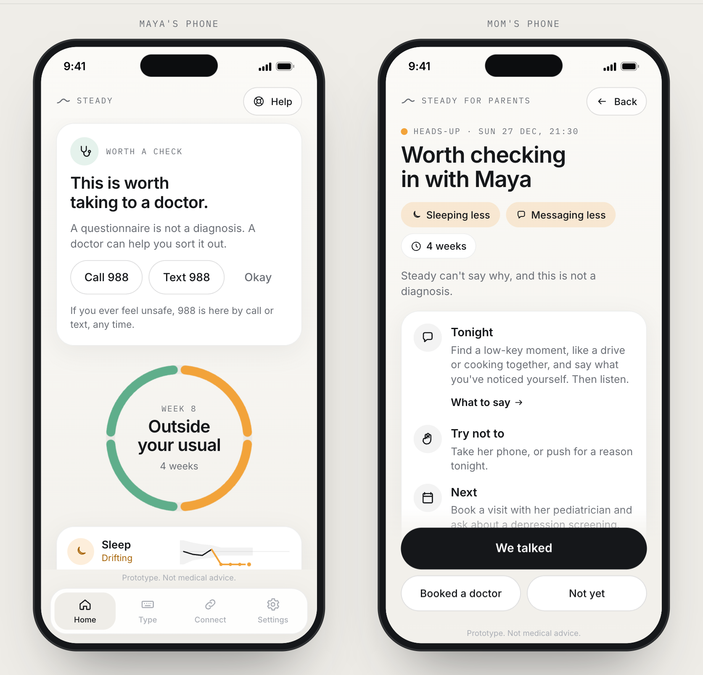

# Stability: knowing when to ask

Entry for the Veritas AI International High School Hackathon 2026, AI + Health track.

Maya is 16. Last fall she quit soccer. By December she slept five hours a night and texted her friends half as much. Her mom thought it was finals, and two months passed before anyone asked how she really was. She is one of many: 1 in 5 US teens has depression each year, and 59% get no treatment ([NIMH](https://www.nimh.nih.gov/health/statistics/major-depression)). Nobody knows when to ask.

**Stability is an app on a teen's phone, linked to a parent's phone, that knows when to ask.**

- **With consent from the teen and a parent,** it connects to her digital life: Instagram, TikTok, YouTube, browsing, newsfeeds, Spotify, games and chats, 17 sources in all. Everything is read on her phone, and parents never see a message, a search or a video.
- **Once a week Stable, the app's mascot, checks in:** two taps, for stress and time with people.
- **Every month it asks the two screening questions doctors use,** and the ask model asks sooner when her answers and check-ins point that way. High answers bring up all eight questions, a nudge to see a doctor, and a short note to her parent: what changed, for how long, and how to start the conversation.
- **Small models on the phone** read what she types, watches and searches, keep only numbers, and delete the words. Words about self-harm bring up 988, one tap away.
- **It works.** Tested on 404,376 labelled examples, the ask model finds a hard week 3.4 times as often as a fixed schedule (44% against 13%), and scored an AUC of 0.90 on 113 teens aged 12 to 17 it never saw. The mood model finds twice what a keyword list does, and the safety check caught 13 of our 15 self-harm test messages.

**This project is a prototype and is not medical advice.**

**Start with [the one-page write-up](WRITEUP.md).** It covers the problem, what we built, the results against a baseline, and where it fails.

- **[The Stability site](https://ameyachoudhary.github.io/VeritasAIHackathon/)** tells the whole idea as you scroll, with the video and a link to the app.
- **[The app](https://ameyachoudhary.github.io/VeritasAIHackathon/app/)** runs in a browser with nothing to install. On a laptop it shows Maya's phone and her mom's side by side: pick "Maya's 12 weeks" and press Play. On a phone it can be added to the home screen and opens offline.
- **[The demo video](docs/video/steady-demo.mp4)** tells Maya's story in under two minutes.



## Status

The experiments have run, and the app works end to end on sample data. No clinician has reviewed any of it.

- **Timing (Experiment 1).** On 213 Dartmouth students, the drift rule picked weeks to ask no better than random weeks from the same student and season. A heads-up from phone signals alone did no better than a calendar. The questionnaire does the real work. [Results](results/exp1/results.md).
- **Deeper check (Experiment 1b).** Using only phone data recorded before the answer, models picked out high PHQ-2 weeks in students they never saw at AUC 0.57 to 0.60. A single check-in from the week before (mood picture, stress, time with others) reached 0.69, and every earlier check-in together 0.74 to 0.78. With every questionnaire input at least 14 days old, earlier PHQ-2 answers plus check-ins reached 0.89, mostly from students who stay high. Adding phone data to the answer history added nothing reliable. Versions built to cheat on purpose reached 0.98. These are cross-validation estimates for each model, checked by an outside review. [Results](results/exp1b/results.md).
- **Asking (Experiment 3).** Every way of picking the week, scored the same way at 12 asks per student-year. 24% of the asks chosen from one short check-in landed on a high week, against 13% for a fixed calendar and 18% for a phone model. Random weeks from the same student and quarter reached 23%, so the check-in finds which students and which term to ask in, and the exact week adds about one point. [Results](results/exp3/results.md).
- **The ask model (Experiment 4).** The model the app now runs to decide when to ask: a logistic regression on this week's check-in, the student's usual check-in, and their last and average PHQ-2 scores. On students it never saw it scored an AUC of 0.89 (0.87 to 0.91). At 12 asks per student-year, 44% of its asks landed on a high week, against 13% for a fixed calendar. It missed 586 of 2,171 high weeks and raised 2,012 false alarms. It finds who to ask more often and does not pick the week: random weeks from the same student and quarter reached 45%. The earlier answers it saw were at least 11 days old, as they would be in the app; with last week's answers the same model scored 0.91. [Results](results/exp4/results.md).
- **Teenagers (Experiment 6).** The ask model from Experiment 4, unchanged, scored 113 teenagers aged 12 to 17 it never saw, from the Corona Health adolescent study. On each teen's first follow-up it scored an AUC of 0.85 (0.78 to 0.92). Asking the top 23% by its score landed on a high PHQ-2 74% of the time, against 41% at random; it missed 14 of 46 high answers and raised 11 false alarms. Over all 635 later answers it scored 0.90: 0.93 for boys and 0.86 for girls. The survey has no check-in, so only the earlier-answers part of the model was tested. The teens were mostly German-speaking, answered during the pandemic and chose when to answer. [Results](results/exp6/results.md).
- **Digital life in US high schools (Experiment 7).** Trained on 19,863 students in the CDC's 2023 Youth Risk Behavior Survey and tested on 10,483 different students in 2025, answers about social media use, sleep and online bullying sorted who had felt sad or hopeless at AUC 0.65 (0.64 to 0.67); sex and grade alone scored 0.62. Sleep showed clear steps: 54% of students sleeping 4 hours or less felt sad or hopeless, against 24% at 8 hours. The app does not read bullying; sleep and social media alone scored 0.61. By group: 0.61 for Black students up to 0.68 for White and 0.69 for Asian students. In NHANES adults aged 18 to 24 (the public file has no PHQ-9 under 18), a PHQ-2 of 3 or more caught 59% of those with a PHQ-9 of 10 or more. This is a one-time survey, so it shows the signals go with depression signs across teens. It does not test one teen's weeks. [Results](results/exp7/results.md).
- **Music, gaming, social media and stress (Experiment 8).** Music habits from 736 listeners lined up with high self-rated depression at AUC 0.57 (0.53 to 0.61); adding how the genres sound, from Spotify's audio features, gave 0.60, and how happy the music sounds made no clear difference. Gaming habits from 13,413 mostly adult gamers lined up with moderate anxiety at 0.59. Social media use alone lined up with often feeling down at 0.67 in 481 people. The app's tone model, never trained on stress, scored 0.75 on stressed Reddit posts (Dreaddit). All four are one-time snapshots across people. [Results](results/exp8/results.md).
- **Groups (Experiment 3).** The check-in model ranked weeks better for men (AUC 0.75) than for women (0.66). Phone data was near chance for every gender and race group with at least 20 students.
- **Words (Experiment 2).** The tone model found 50% of low-mood Reddit comments at 59% precision, against 24% at 48% for a keyword list. It was retrained on how many raters marked each comment; the earlier version found 55% at 52% precision. The self-harm phrase list missed 9 of 15 risk messages written blind. [Results](results/exp2/results.md).
- **Self-harm language (Experiment 5).** A model in the tone model's format, trained on 282,768 Reddit and other posts from two Kaggle sets to tell self-harm language apart from sad, anxious or ordinary posts. On 28,277 held-out posts it found 92% of self-harm posts at 90% precision (989 missed, 1,316 false alarms); the phrase list found 52% at 92% (6,075 missed, 596 false alarms). It also flagged 32% of depression posts, against 20% for the phrase list. On our 60 messages the phrase list plus the model found 13 of 15 risk messages with 5 false alarms, against 6 with 4 for the phrase list alone. It passed a rule we wrote before running it, so the app runs it beside the phrase list. [Results](results/exp5/results.md).
- **The self-harm model on labels from psychiatrists (Experiment 5b).** Experiment 5's labels come from the forum a post was in, and one set uses r/teenagers as the "not suicidal" side, so the model could have learned the forum. We tested it, unchanged, on 500 Reddit users rated by four psychiatrists on the Columbia scale ([Gaur et al., WWW 2019](https://zenodo.org/records/4543776), CC BY 4.0), all from the same forums. It ranked the 293 users at risk above the rest at an AUC of 0.66. It flagged 99% of users at risk, but also 86% of users only supporting others and 91% of users with only indicators; the phrase list flagged 70%, 45% and 47% of those groups. It learned the language of suicide, not the risk. So a flag from the model alone now only asks the teen "Are you safe right now?" with 988; no answer sends nothing, and only "no" sends a note. [Results](results/exp5b/results.md).
- **A fine-tuned tone model (Experiment 2b).** A small language model (`all-MiniLM-L6-v2`), fine-tuned on the same data, found 62% of low-mood comments at 63% precision (131 missed, 127 false alarms), against 50% at 59% (171 missed, 123 false alarms) for the model in the app. On our 60 teen-style messages it found 13 of 33 with 8 false alarms, against 12 with 2, because it flags dark jokes. It is 91 MB against 698 KB. It is not in the app. [Results](results/exp2b/results.md).
- **Stable, the mascot.** A small sage character with a sprout who does the weekly check-in. It floats and blinks, turns amber with a soft pulse when it has a question, and squints happily after an answer. It is kept off the safety and 988 screens on purpose.
- **The app.** A teen phone and a parent phone side by side, playing the rules in [Parent alerts](docs/parent-alerts.md) with made-up data and a simulated clock. The teen's Home screen has the two-tap check-in, led by Stable, the app's mascot, and the ask model from Experiment 4 decides when the two questions come up. Events move between browser tabs; there is no server yet. It installs to a phone's home screen and opens offline.
- **Her digital life.** 17 sources, all read on the phone: school (Classroom, Canvas, Schoology), Gmail, Calendar, Microsoft 365 and Drive, music (Last.fm, Spotify by sign-in or data file), Fitbit, the Android phone app (screen time, game time, sleep, steps, the keyboard), Instagram, TikTok, Snapchat and Discord data files, and YouTube and Chrome history from Google Takeout. Video titles, searches and page titles are scored for mood and self-harm on the phone, then dropped; news-site visits are counted. Music gets a mood score from Spotify's audio features for each song. Only weekly numbers are kept, and the new counts are shown to the teen, never sent to a parent. Each source works with sample data. Live Spotify sign-in runs in Spotify's development mode, which allows the owner and up to 5 listed users; a public launch would need Spotify's approval, because its developer policy restricts building metrics from listening. Other real sign-ins need keys the team creates (see [app/README.md](app/README.md)) and have not been tested end to end.
- **Screen time.** The Android app in [native/android](native/android/) builds and runs in an emulator. The iPhone version in [native/ios](native/ios/) builds with no warnings in Xcode 27 and runs in the Simulator up to the Screen Time permission, which the Simulator cannot grant. Reading real screen time needs a real iPhone and an Apple developer team.

## What is here

| Path | What it is |
| --- | --- |
| [WRITEUP.md](WRITEUP.md) | The one-page write-up in the hackathon's template |
| [docs/video-script.md](docs/video-script.md) | The demo video's script, and how to record your own voice over it |
| [docs/concept.md](docs/concept.md) | The concept: the problem, what people need, what Stability is, how it decides, how we will build it, and the hard questions |
| [docs/parent-alerts.md](docs/parent-alerts.md) | When a parent is told, what each note says, what leaves the phone, and what this does not solve |
| [docs/signals-and-model-ideas.md](docs/signals-and-model-ideas.md) | Every signal we considered, how music fits, nine ideas for the model, and what a phone can and cannot see |
| [docs/Stability-product-concept.pdf](docs/Stability-product-concept.pdf) | An earlier, longer version of the concept (17 pages). It describes our first design, where the student decided whether an adult was told. [Parent alerts](docs/parent-alerts.md) replaces that part. Where the PDF and these docs differ, the docs are current |
| [app/](app/) | The working prototype: teen phone, parent phone and demo controls. See [app/README.md](app/README.md) |
| [site/](site/) | The landing page: a static, scroll-driven page with no build step |
| [video/](video/) | The demo video's source: script, teleprompter, scenes, and the tools that time every animation to the voice. See [docs/video-script.md](docs/video-script.md) |
| [native/](native/) | Screen-time collectors: an Android app and an iPhone app with two Screen Time extensions, both building |
| [experiments/exp1_timing.py](experiments/exp1_timing.py) | Experiment 1: does the drift rule pick better weeks to ask, and to alert a parent, than a calendar? |
| [experiments/exp1b_deeper.py](experiments/exp1b_deeper.py) | Experiment 1b: the best honest numbers across five framings, with leakage checks, deliberate leaks for comparison, and two outside datasets (Depresjon, StudentLife) |
| [experiments/exp2_words.py](experiments/exp2_words.py) | Experiment 2: the tone model and the self-harm phrase check, with [our 60 test messages](experiments/exp2_words/test_messages.csv) |
| [experiments/exp3_asking.py](experiments/exp3_asking.py) | Experiment 3: the drift rule, a phone model, check-in models and a follow-up rule at the same number of asks, and the same numbers by gender and race |
| [experiments/exp4_ask_model.py](experiments/exp4_ask_model.py) | Experiment 4: trains and tests the ask model, and writes the weights the app loads (`app/src/engine/ask_model.json`) |
| [experiments/exp5_risk_words.py](experiments/exp5_risk_words.py) | Experiment 5: trains and tests the self-harm language model against the phrase list, and writes the model the app loads (`app/public/models/risk.json`) when it passes the rule set before the run |
| [experiments/exp5b_cssrs.py](experiments/exp5b_cssrs.py) | Experiment 5b: tests the shipped self-harm model, unchanged, on 500 Reddit users labelled by psychiatrists |
| [experiments/exp6_teens.py](experiments/exp6_teens.py) | Experiment 6: tests the shipped ask model, unchanged, on 113 teenagers aged 12 to 17 |
| [experiments/exp7_digital_life.py](experiments/exp7_digital_life.py) | Experiment 7: social media, sleep and online bullying against feeling sad or hopeless in 30,346 US high schoolers (CDC YRBS 2023 and 2025), and the PHQ-2 step on NHANES |
| [experiments/exp8_music_gaming.py](experiments/exp8_music_gaming.py) | Experiment 8: music (with Spotify audio features), gaming, social media and stress language against distress |
| [experiments/exp2b_finetune.py](experiments/exp2b_finetune.py) | Experiment 2b: fine-tunes a small language model for tone and compares it with the model in the app |
| [notebooks/](notebooks/) | The experiments as executed notebooks with charts |
| [results/](results/) | Write-ups and every number for each experiment |
| [scripts/get_data.sh](scripts/get_data.sh) | Downloads the open data into `data/`. [docs/datasets.md](docs/datasets.md) lists each dataset with its licence |
| [scripts/build_music_mood.py](scripts/build_music_mood.py) | Builds the app's music mood table from the Spotify Tracks Dataset |
| [audit/audit_reddit_dataset.py](audit/audit_reddit_dataset.py) | The audit of a dataset we decided not to train on |
| [audit/results.txt](audit/results.txt) | The output of that audit |

## Run it

**The app** needs Node 22 or newer:

```
cd app
npm install
npm run dev -- --port 5210 --host 127.0.0.1
```

Then open http://127.0.0.1:5210 (Spotify sign-in only accepts that address, not localhost). Pick "Maya's 12 weeks" and press Next week or Play. `npm test` runs the 274 tests. Everything runs in the browser and works offline once loaded.

**The site** has no build step. From the repo root, run `python3 -m http.server 8000` and open http://localhost:8000/site/. Its links to the app work once the site is deployed, where the app sits at `/app/`.

**The video** needs Node 22 and ffmpeg:

```
cd video
npm install
npx remotion render src/index.ts Main out/steady-demo.mp4
```

**The experiments** need Python 3.13. The College Experience Study has its own terms: academic or educational use only, and no attempt to re-identify anyone. Downloading it means you accept them.

```
bash scripts/get_data.sh
python3 -m venv .venv && source .venv/bin/activate
pip install -r requirements.txt
python experiments/exp1_timing.py
python experiments/exp1b_deeper.py
python experiments/exp2_words.py
python experiments/exp3_asking.py
python experiments/exp4_ask_model.py
python experiments/exp5_risk_words.py
python experiments/exp5b_cssrs.py
python experiments/exp6_teens.py
python experiments/exp2b_finetune.py   # optional
```

Experiment 1 takes about a minute, Experiment 1b about five, Experiment 2 about ten seconds, Experiment 3 about two minutes, Experiment 4 under a minute, Experiment 5 about two minutes and Experiment 6 a few seconds. Experiments 3 and 4 read the tables the first two build. Experiment 4 also writes the ask model the app loads, and Experiment 5 the self-harm model. Experiment 5 needs the two Kaggle files the data script downloads: [Suicide and Depression Detection](https://www.kaggle.com/datasets/nikhileswarkomati/suicide-watch) (CC BY-SA 4.0; cite Komati et al., "Suicide Ideation Detection in Social Media Forums", IEEE 2021) and [Sentiment Analysis for Mental Health](https://www.kaggle.com/datasets/szegeelim/mental-health) (ODbL), about 200 MB together. Experiment 5b needs the Reddit C-SSRS set (Gaur et al., [Zenodo](https://zenodo.org/records/4543776), CC BY 4.0), which the script puts in `data/reddit_cssrs/`. Experiment 6 needs the Corona Health adolescent study ([Zenodo](https://zenodo.org/records/15101756), CC BY 4.0, University of Wurzburg), which the script puts in `data/corona_health_ado/`. Experiment 2b is optional: it needs `torch` and `transformers` (both in `requirements.txt`), downloads a 90 MB pretrained model from Hugging Face, and took 11 minutes on an Apple GPU. We re-ran Experiments 1, 1b and 2 from the raw data on a second computer: Experiments 1 and 2 gave the same numbers, and Experiment 1b's AUCs matched to within 0.001. The data script carries on if Depresjon or StudentLife fails to download, and Experiment 1b then leaves that dataset out. If Depresjon's own server fails, the script falls back to a public-domain copy of it on [Kaggle](https://www.kaggle.com/datasets/arashnic/the-depression-dataset). Depresjon asks for a citation of Garcia-Ceja et al., MMSys 2018, and StudentLife (CC BY 4.0) of Wang et al., UbiComp 2014. Experiment 2 also writes the tone model the app loads.

## The dataset audit

Before training on [Depression: Reddit Dataset (Cleaned)](https://www.kaggle.com/datasets/infamouscoder/depression-reddit-cleaned), we checked whether a rule that ignores meaning could score well on it. It can, so we will not train on it.

Results on a held-out test set of 1,530 posts:

| Method | Accuracy | Missed cases | False alarms |
| --- | --- | --- | --- |
| Always guess the most common label | 50.8% | 752 | 0 |
| Word count only ("more than 29 words") | 87.5% | 188 | 4 |
| Keyword list | 82.0% | 268 | 7 |
| TF-IDF + logistic regression, full text | 95.6% | 58 | 9 |
| The same model, first 14 words only, give-away words removed | 81.3% | 161 | 125 |

This set is one of the nine merged into the Sentiment Analysis for Mental Health set used in Experiment 5. There both of its labels count as not self-harm, so its own shortcut does not separate the labels Experiment 5 learns.

Counting words gets 87.5% without reading anything. No post labelled "not depression" is longer than 42 words, and the model's strongest words for that label include "sleep", "sad" and "miss". A model can score high here from post length and source alone, so the 95.6% does not show that it has learned signs of depression.

To run it again, download the CSV from the link above, then:

```
python -m venv .venv && source .venv/bin/activate
pip install pandas==3.1.1 numpy==2.5.4 scikit-learn==1.9.1
python audit/audit_reddit_dataset.py path/to/depression_dataset_reddit_cleaned.csv
```

The experiments need everything in `requirements.txt`; the audit needs only these three.

## Credits

The concept was researched and drafted with Claude (Anthropic), using Claude Code. The audit script was written with it too. Sources are linked where each figure appears in the docs.
