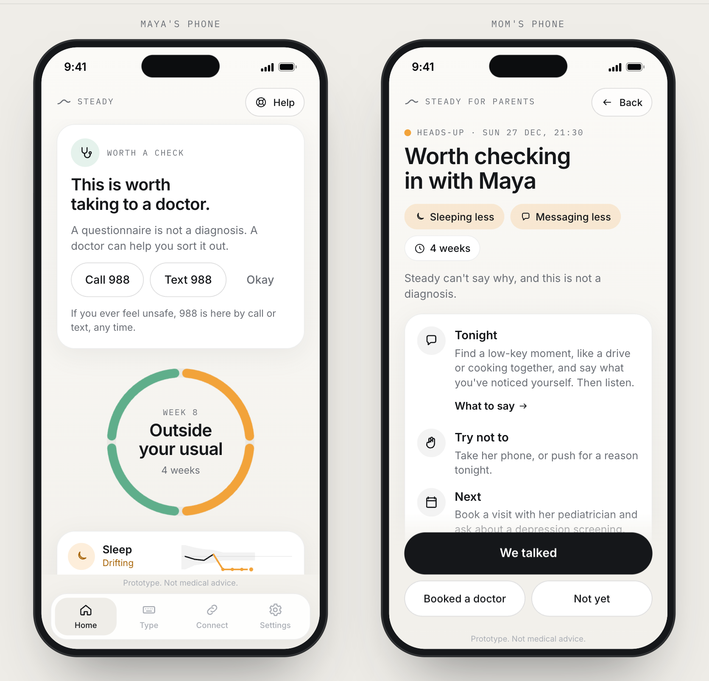

# Stability: knowing when to ask

**Track:** Health
**Team:** two high school students (names are on the submission form)
**Try it:** [the app](https://ameyachoudhary.github.io/VeritasAIHackathon/app/) runs in a browser with nothing to install, [the site](https://ameyachoudhary.github.io/VeritasAIHackathon/) walks through the idea, and [the video](docs/video/steady-demo.mp4) shows it in two minutes.

*This project is a prototype and is not medical advice.*

## The problem

One in five US teenagers has a major depressive episode in a year, and 59% of them get no treatment ([NIMH](https://www.nimh.nih.gov/health/statistics/major-depression)). It rarely starts as a crisis. It builds over weeks of worse sleep, fewer messages and dropped plans, while the two screening questions that catch it are asked about once a year. Parents notice changes but cannot tell a hard week from something more, so most teens are never asked at the moment it would matter.

## What we built

Stability is a phone app for teens, linked to a parent's phone. It decides when to ask the two screening questions doctors use, and brings in a parent only when the answers say it matters.

- **Consent first.** The teen and a parent both agree at setup. Everything is read on the teen's phone. Parents never see a message, a search, a video or a score.
- **In:** a two-tap weekly check-in from Stable, the app's mascot (stress, and time with people); the teen's earlier answers; and their digital life from 17 sources, including Instagram, TikTok, YouTube, browsing, newsfeeds, Spotify, games, chats, sleep and school. Only weekly numbers are kept.
- **Out, for the teen:** the PHQ-2 at the right moment, the full PHQ-8 if it comes back high, a nudge to see a doctor, and the 988 crisis line one tap away whenever they type or search words about self-harm.
- **Out, for the parent:** a short note when the PHQ-8 reaches 10: what changed (for example, sleep and messaging), for how long, and how to start the conversation.

**Example.** In our demo, a 16-year-old scores 2 of 6 in week 4. During finals her check-ins show more stress, so the ask model asks again two weeks early. In week 8 she scores 12 on the full eight: she is nudged to see a doctor, and her mom learns that sleep and messaging have been down for four weeks.

## What we added

Our own idea. Our question: can a phone pick the right moment to ask a teen the screening questions, better than a calendar can?

## How it works

**Data.** 404,376 labelled examples from public datasets. Every model was tested on people or posts it never trained on:

| Dataset | What it is | Used for |
| --- | --- | --- |
| [College Experience Study](https://www.kaggle.com/datasets/subigyanepal/college-experience-dataset) | 213 students, 16,886 weeks with a PHQ-2 | Training the ask model |
| [Corona Health adolescents](https://zenodo.org/records/15101756) | 113 teens aged 12 to 17, 635 later answers | Testing the ask model on teens |
| [GoEmotions](https://huggingface.co/datasets/google-research-datasets/go_emotions) | 54,263 rated comments | The mood model |
| Kaggle self-harm sets ([1](https://www.kaggle.com/datasets/nikhileswarkomati/suicide-watch), [2](https://www.kaggle.com/datasets/szegeelim/mental-health)) | 282,768 posts after removing duplicates | The self-harm model |
| [CDC YRBS](https://www.cdc.gov/yrbs/) 2023 and 2025 | 30,346 high schoolers | Which digital-life signals go with distress |

**Models.** All three run on the phone.

- **The ask model** is a logistic regression on six numbers: this week's two taps, the teen's usual taps, and their last and average PHQ-2. Past a 16% chance that the next screening is high, it asks; everyone is also asked monthly. A PHQ-2 of 3 or more brings up the PHQ-8, and 10 or more on the PHQ-8 alerts a parent. Random forests, boosted trees and a neural net all tied with it, so we kept the model that fits on a phone and that a doctor can read.
- **The mood model** (TF-IDF with logistic regression, 698 KB) reads the tone of what the teen types and searches.
- **The self-harm model** (1 MB) works alongside a hand-written phrase list.

Both text models keep numbers and delete the words.

## Results

Every number below is on data the model never saw.

- **3.4 times better timing:** 44% of the ask model's questions reached a teen in a hard week, against 13% for a fixed schedule.
- **It holds up on teenagers:** unchanged, AUC 0.90 on 113 teens aged 12 to 17 (0.85 on first follow-ups alone).
- **Twice as good as keywords** at reading low mood, and 13 of our 15 self-harm test messages caught, against 6 for a phrase list.
- **Sleep matters:** in the CDC's 2025 survey, 54% of high schoolers sleeping 4 hours or less felt sad or hopeless, against 24% at 8 hours.

| Question | Simple baseline | Our model | Test set |
| --- | --- | --- | --- |
| Which weeks to ask, at 12 asks a year? | Fixed schedule: 13%. 1,670 high weeks missed, 3,391 false alarms | 44% (AUC 0.89). 586 of 2,171 missed, 2,012 false alarms | 213 students |
| Does it work on teens? | At random: 37% | 92% (AUC 0.90). 103 of 238 missed, 12 false alarms | 113 teens |
| Is this message low mood? | Keyword list: 24%. 263 missed, 89 false alarms | 50%. 171 missed, 123 false alarms | 5,427 comments |
| Is this post about self-harm? | Phrase list: 52%. 6,075 missed, 596 false alarms | 92% at 90% precision. 989 missed, 1,316 false alarms | 28,277 posts |

**Where it failed, and what we changed.**

- **Our first idea failed.** We began by asking whenever two phone signals left a teen's normal range. That picked weeks no better than chance (14.6% against 14.9% at random). So Stability asks first, and phone signals explain what changed ([Experiment 1](results/exp1/results.md)).
- **The self-harm model confused helpers with people at risk.** On 500 Reddit users rated by psychiatrists, it flagged 86% of people who were only supporting others (AUC 0.66). So a flag from the model alone only asks the teen "Are you safe right now?", and only a "no" reaches a parent ([Experiment 5b](results/exp5b/results.md)).

**Groups and limits.**

- **Groups:** on teens, the ask model scored 0.93 for boys and 0.86 for girls. College check-ins scored 0.75 for men and 0.66 for women.
- **It finds who to ask more than which week:** random weeks for the same students did nearly as well (45%) ([Experiment 4](results/exp4/results.md)).
- **The teen test set** was German-speaking and collected during the pandemic ([Experiment 6](results/exp6/results.md)).

## What we'd do next

1. **Test with US high schoolers, weekly,** to measure the check-in and the ask model together.
2. **Train the self-harm model on clinician-labelled data,** and have a clinician review it and every parent note.

## Sources

- **Statistics:** [NIMH, major depression](https://www.nimh.nih.gov/health/statistics/major-depression) (2021 NSDUH); [CDC Youth Risk Behavior Survey](https://www.cdc.gov/yrbs/) 2023 and 2025.
- **Datasets:** the five in the table above, plus Reddit C-SSRS, NHANES and others, with licences in [docs/datasets.md](docs/datasets.md).
- **Questionnaires:** PHQ-2 and PHQ-8 (Kroenke, Spitzer and Williams).
- **Libraries:** scikit-learn, pandas, React, Vite, Remotion and PyTorch ([full list](app/README.md)).
- **AI tools:** Claude (Anthropic), in Claude Code, wrote code and drafted documents with us. Codex (OpenAI) reviewed experiments and app code. The video's narration is our own voices; drafts used a placeholder voice (en-US-AvaNeural via edge-tts) for timing.
- **Full results:** [results/](results/), one write-up per experiment.
