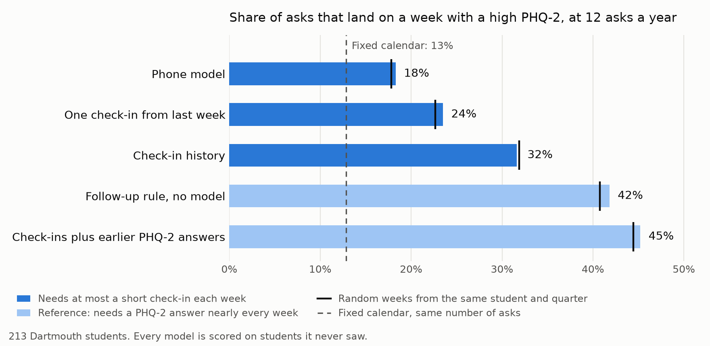

# Steady: knowing when to ask

**Track:** Health
**Team:** two high school students (names are on the submission form)
**Try it:** [the app](https://ameyachoudhary.github.io/VeritasAIHackathon/app/) runs in a browser with nothing to install, and [the site](https://ameyachoudhary.github.io/VeritasAIHackathon/) walks through the idea.

*This project is a prototype and is not medical advice.*

## The problem

One in five US teenagers has a major depressive episode in a year, and only about 40% of them get treatment ([NIMH](https://www.nimh.nih.gov/health/statistics/major-depression)). It builds over weeks, so no single day looks alarming, and the screening questions that work are asked about once a year at a checkup. Our user is Maya, 16, and her mom, who would not see a slow slide until it became a crisis.

## What we built

Steady is a prototype app on a teen's phone, linked once to a parent's phone.

- **In:** weekly phone signals (sleep, messaging, activity), the words the teen types, and their answers to the PHQ-2 and PHQ-8 screening questions.
- **Out:** for the teen, the screening questions and a suggestion to see a doctor. For the parent, a short note saying what changed, for how long, and how to start the conversation. A note never contains messages, answers or scores.
- **Demo:** both phones side by side. Press Play to watch Maya's 12 weeks. Type in the Type tab and the tone model scores your words in the browser. On a phone, the app installs to the home screen and runs offline.

## What we added

Our own idea, with our own question: can a phone tell us when to ask a teenager the screening questions, better than a calendar can?

## How it works

**Data**

- [College Experience Study](https://www.kaggle.com/datasets/subigyanepal/college-experience-dataset) (Dartmouth): 213 students and 16,886 student-weeks with a PHQ-2 answer. A week needs four usable days of phone data, and it counts as high when PHQ-2 is 3 or more (12.9% of weeks).
- [GoEmotions](https://huggingface.co/datasets/google-research-datasets/go_emotions) (Google): 54,263 Reddit comments in its own train, validation and test split. Low mood means sadness, grief, disappointment or remorse (6.4% of test comments).
- 60 teen-style messages to find failures, written by a separate AI session that had not seen our rules.

**Models**

- **When to ask.** We started with a drift rule: two phone signals outside the student's own range for two weeks. We then trained logistic regressions on phone data and on the student's own short check-ins. Students, never weeks, are split between training and test.
- **Tone.** TF-IDF over words and word pairs, then logistic regression. It is 698 KB, so it runs on the phone. It is trained on the share of raters who marked each comment as low mood. The threshold was chosen on validation data only.
- **Self-harm check.** A phrase list kept separate from the tone model. It is not machine learning and is not validated.

## Results

| Question | Simple baseline | Our models | Held-out test data |
| --- | --- | --- | --- |
| Is this message low mood? | Keyword list finds 24%: 263 missed, 89 false alarms | Tone model finds 50%: 171 missed, 123 false alarms | 5,427 comments, 345 of them low mood |
| Which weeks should Steady ask, at 12 asks a year? | Fixed calendar: 13% of asks land on a high week; 1,670 of 2,171 high weeks missed, 3,391 false alarms | Phone model: 18%. One check-in from the week before: 24%; 1,227 high weeks missed, 3,071 false alarms | 213 students; every model is scored on students it never saw |

**Our main finding is that asking beat watching.** Our first idea failed its own test: the drift rule picked weeks no better than random weeks from the same student and term (14.6% against 14.9%). One short check-in from the student did better than a model with 686 phone features. It works by finding which students and which term to ask in. Random weeks from the same student and term reached 23%, so the exact week adds about one point.

**Where it fails**

- **Timing.** Even the check-in model missed 1,227 of 2,171 high weeks at this budget, and 3,071 of its asks landed on weeks that were not high.
- **Groups.** The check-in model ranked weeks better for men (AUC 0.75) than for women (0.66), and we do not know why. Phone data was near chance for every gender and race group we could check. GoEmotions records nothing about its writers, so the tone model could not be checked.
- **Tone.** On our teen-style messages the model found 12 of 33. It learned from adult Reddit comments, and "sorry im late lol" scores as low mood.
- **Self-harm.** The phrase list missed 9 of 15 risk messages, most by one word: it has "this is my goodbye" and missed "this is goodbye". It also flagged 4 of 24 jokes, lyrics and sarcastic messages.
- **Who was studied.** Every student was in college, not high school.

## What we'd do next

1. Change the app's rules to match the evidence. The demo still runs the drift rule. The next version would ask everyone on a calendar, add a short check-in each week, ask more often when check-ins are low, and follow up soon after a high answer.
2. Replace the phrase list with a model built for self-harm language, have a clinician review every rule and every parent note, and test with high school students.

## Sources

- **Datasets:** College Experience Study (Nepal et al., IMWUT 2024; CC BY-NC-SA 4.0), GoEmotions (Apache-2.0), [Depresjon](https://datasets.simula.no/depresjon/) (Garcia-Ceja et al., MMSys 2018) and [StudentLife](https://zenodo.org/records/3529253) (Wang et al., UbiComp 2014; CC BY 4.0).
- **Questionnaires:** PHQ-2 and PHQ-8 (Kroenke, Spitzer and Williams).
- **Libraries:** scikit-learn, pandas, matplotlib, React, Vite and Remotion; the rest are listed in [app/README.md](app/README.md). No pretrained models.
- **AI tools:** Claude (Anthropic), through Claude Code, wrote the code and drafted the documents with us. Codex (OpenAI) reviewed Experiment 1b. The demo video's placeholder voice is Microsoft's en-US-AvaNeural, through edge-tts.
- **Full results:** [Experiment 1](results/exp1/results.md), [Experiment 1b](results/exp1b/results.md), [Experiment 2](results/exp2/results.md) and [Experiment 3](results/exp3/results.md).
