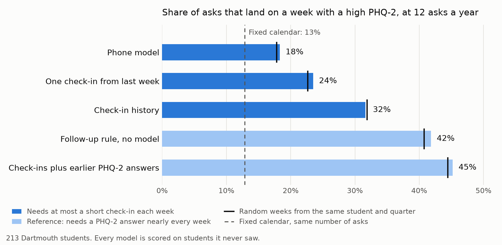

# Experiment 3: one scale for every way of picking the week

Generated 2026-11-15 by `experiments/exp3_asking.py`. Data: College Experience Study (Dartmouth), CC BY-NC-SA 4.0, used for academic purposes only. Every number below is an aggregate over at least 20 students. No student ids or per-student rows appear in this file.

## Short answer

At 12 asks per student-year, 24% of the asks chosen from one check-in landed on a week with a high PHQ-2, against 13% for a fixed calendar and 18% for a phone model; random weeks from the same student and quarter reached 23%, so nearly all of the gain comes from finding which students and which term to ask in, and the choice of week adds about one point.

- **One check-in beats the calendar.** 23.5% of its asks landed on a high week against 12.9% (+10.6 points, 95% interval 7.4 to 14.1 points). It reached 74% of low periods against 61% for the calendar.
- **Most of the gain is in who and when, and little is in which week.** Random weeks that keep the model's number of asks for each student in each quarter reached 22.6% (21.9% to 23.3%). That accounts for 9.8 of the 10.6 points. The model's own choice of week adds the rest: 1% of the random draws did at least as well as it did. Leaving out the quarters where it asked every week, its hit rate was 23.4% against 22.3% for chance in the same quarters.
- **The phone model shows the same pattern lower down.** 18.3% against 12.9% for the calendar, with matched random weeks at 17.8%. It reached 49% of low periods, fewer than the calendar.
- **High answers last.** The follow-up rule has no model: it asks where the last PHQ-2 answer was highest. 41.8% of its asks found another high week, and adding check-ins and a model gave 45.2%. Both need a PHQ-2 answer nearly every week, so they are reference rows.
- **It does not work equally well for everyone.** The one-check-in model ranked weeks better for men (AUC 0.75 (0.69 to 0.81)) than for women (0.66 (0.62 to 0.69)).



## What we tested

Experiment 1 asked whether the drift rule picks better weeks than a calendar, and Experiment 1b measured models by AUC. Here every method is scored the way Experiment 1 scored the drift rule. Each method gives every monitored week a score, and the highest-scoring weeks get the asks. Every method gets the same number of asks.

| Method | What it uses | When it decides | What it needs from the student |
| --- | --- | --- | --- |
| Phone model | Phone data from the week itself (every daily measure, as in Experiment 1b's same-week framing) | end of the week | Nothing from the student |
| One check-in from last week | The latest mood picture, stress and time-with-others answer from the previous calendar week | Monday | A short check-in each week |
| Check-in history | Last week's check-ins, the average of every earlier check-in, and the change between them | Monday | A short check-in each week |
| Check-ins plus earlier PHQ-2 answers (reference) | Check-in history plus the student's earlier PHQ-2 answers, all dated before Monday | Monday | A PHQ-2 answer nearly every week (reference only) |
| Follow-up rule, no model (reference) | The most recent PHQ-2 answer before Monday: ask again where the last answer was highest | Monday | A PHQ-2 answer nearly every week (reference only) |

## Data

| Item | Value |
| --- | --- |
| Students | 213 |
| Monitored student-weeks | 22,688 |
| Monitored weeks with a label | 16,886 |
| Base rate (labelled weeks at 3 or more) | 12.9% |
| Monitored weeks with a check-in in the week before | 80% |
| Monitored weeks with an earlier PHQ-2 answer | 100% |

## Rules and choices

- **Weeks, labels, low periods and baselines** are Experiment 1's, from the same code.
- **Models.** Experiment 1b's logistic regression, in 5 folds split by student. Each model is fit on the labelled weeks of the other folds' students and scores every monitored week of its own fold's students, labelled or not.
- **Picking the weeks.** Inside each fold, the monitored weeks with the highest scores get the asks, up to the budget. Labels are never used to pick. Ties are broken at random with a fixed seed.
- **Fixed calendar and random weeks.** Each method is compared with a calendar that asks the same number of times, and with random weeks that keep the method's count for each student in each calendar quarter. The second comparison shows whether a method picks the right week, or only the right student and season.
- **Missed cases and false alarms.** A high week with no ask is a missed case. An ask on a labelled week that was not high is a false alarm.

## Result: the drift rule's own budget (21.4 asks per student-year)

| Method | Hit rate | Fixed calendar | Method minus calendar (95% interval) | Random weeks, same student and quarter | High weeks missed | False alarms | Low periods reached | Low periods reached, calendar |
| --- | --- | --- | --- | --- | --- | --- | --- | --- |
| Drift rule (Experiment 1) | 14.6% | 12.9% | +1.8 points (0.0 to 3.7 points) | 14.9% | 1,164 of 2,171 | 5,869 | 55% | 88% |
| Phone model | 15.7% | 12.9% | +2.9 points (0.7 to 4.9 points) | 15.7% | 1,120 of 2,171 | 5,623 | 68% | 88% |
| One check-in from last week | 20.6% | 12.9% | +7.7 points (5.6 to 9.9 points) | 20.1% | 853 of 2,171 | 5,095 | 86% | 88% |
| Check-in history | 23.8% | 12.9% | +11.0 points (7.7 to 14.3 points) | 23.9% | 580 of 2,171 | 5,083 | 82% | 88% |
| Check-ins plus earlier PHQ-2 answers (reference) | 30.2% | 12.9% | +17.3 points (14.5 to 20.3 points) | 29.5% | 189 of 2,171 | 4,588 | 98% | 88% |
| Follow-up rule, no model (reference) | 28.9% | 12.9% | +16.0 points (13.2 to 18.5 points) | 28.1% | 236 of 2,171 | 4,758 | 99% | 88% |

## Result: 12 asks a year (monthly) (12.0 asks per student-year)

| Method | Hit rate | Fixed calendar | Method minus calendar (95% interval) | Random weeks, same student and quarter | High weeks missed | False alarms | Low periods reached | Low periods reached, calendar |
| --- | --- | --- | --- | --- | --- | --- | --- | --- |
| Phone model | 18.3% | 12.9% | +5.4 points (2.5 to 8.6 points) | 17.8% | 1,501 of 2,171 | 2,990 | 49% | 61% |
| One check-in from last week | 23.5% | 12.9% | +10.6 points (7.4 to 14.1 points) | 22.6% | 1,227 of 2,171 | 3,071 | 74% | 61% |
| Check-in history | 31.6% | 12.9% | +18.8 points (13.3 to 24.2 points) | 31.9% | 981 of 2,171 | 2,573 | 65% | 61% |
| Check-ins plus earlier PHQ-2 answers (reference) | 45.2% | 12.9% | +32.4 points (27.5 to 37.2 points) | 44.4% | 541 of 2,171 | 1,975 | 88% | 61% |
| Follow-up rule, no model (reference) | 41.8% | 12.9% | +29.0 points (24.0 to 33.0 points) | 40.8% | 616 of 2,171 | 2,163 | 95% | 61% |

## Result: 6 asks a year (every two months) (6.0 asks per student-year)

| Method | Hit rate | Fixed calendar | Method minus calendar (95% interval) | Random weeks, same student and quarter | High weeks missed | False alarms | Low periods reached | Low periods reached, calendar |
| --- | --- | --- | --- | --- | --- | --- | --- | --- |
| Phone model | 20.5% | 12.9% | +7.6 points (3.0 to 12.3 points) | 20.1% | 1,801 of 2,171 | 1,433 | 28% | 34% |
| One check-in from last week | 28.5% | 12.9% | +15.6 points (10.0 to 21.5 points) | 27.8% | 1,598 of 2,171 | 1,437 | 52% | 34% |
| Check-in history | 40.0% | 12.9% | +27.1 points (19.2 to 35.6 points) | 39.4% | 1,409 of 2,171 | 1,142 | 48% | 34% |
| Check-ins plus earlier PHQ-2 answers (reference) | 60.2% | 12.9% | +47.3 points (39.9 to 55.1 points) | 59.4% | 1,048 of 2,171 | 742 | 66% | 34% |
| Follow-up rule, no model (reference) | 62.8% | 12.9% | +49.9 points (44.0 to 54.7 points) | 60.8% | 1,012 of 2,171 | 687 | 85% | 34% |

At a smaller budget every method misses more high weeks, because there are fewer asks to go round. The calendar's own counts for missed weeks and false alarms are in `results.json`, with the check that leaves out quarters where a method asked every week.

## How well each score ranks weeks

AUC on all labelled monitored weeks, from the same out-of-fold scores. Within-student AUC compares only weeks of the same student. These rows use Experiment 1's weeks, so they differ a little from Experiment 1b's.

| Method | AUC (95% interval) | Within-student AUC |
| --- | --- | --- |
| Phone model | 0.57 (0.51 to 0.63) | 0.57 |
| One check-in from last week | 0.69 (0.66 to 0.72) | 0.61 |
| Check-in history | 0.78 (0.74 to 0.82) | 0.64 |
| Check-ins plus earlier PHQ-2 answers (reference) | 0.90 (0.88 to 0.92) | 0.72 |
| Follow-up rule, no model (reference) | 0.88 (0.85 to 0.90) | 0.74 |

## Groups

The hackathon asks whether a model works equally well across groups. The study records self-reported gender and race. The tone model in Experiment 2 cannot be checked this way, because GoEmotions records nothing about who wrote each comment.

**By gender**

| Group | Students | Labelled weeks | Base rate | Drift rule: hit rate vs calendar vs matched random | Phone model AUC | One check-in AUC | Follow-up rule AUC | One check-in at 12 asks: hit rate vs calendar | Asks per student-year it gave this group |
| --- | --- | --- | --- | --- | --- | --- | --- | --- | --- |
| Women | 142 | 11,613 | 11.8% | 13.1% vs 11.8% vs 13.5% | 0.57 (0.51 to 0.64) | 0.66 (0.62 to 0.69) | 0.86 (0.83 to 0.88) | 19.6% vs 11.8% (above the calendar) | 12.4 |
| Men | 68 | 5,064 | 15.3% | 17.5% vs 15.3% vs 17.6% | 0.56 (0.43 to 0.67) | 0.75 (0.69 to 0.81) | 0.91 (0.86 to 0.94) | 33.5% vs 15.2% (above the calendar) | 11.2 |

**By race**

| Group | Students | Labelled weeks | Base rate | Drift rule: hit rate vs calendar vs matched random | Phone model AUC | One check-in AUC | Follow-up rule AUC | One check-in at 12 asks: hit rate vs calendar | Asks per student-year it gave this group |
| --- | --- | --- | --- | --- | --- | --- | --- | --- | --- |
| Asian | 51 | 3,922 | 11.5% | 12.4% vs 11.4% vs 12.9% | 0.58 (0.45 to 0.69) | 0.69 (0.63 to 0.74) | 0.85 (0.79 to 0.89) | 20.8% vs 11.5% (above the calendar) | 12.8 |
| White | 133 | 10,596 | 14.1% | 17.0% vs 14.1% vs 17.1% | 0.56 (0.49 to 0.63) | 0.70 (0.66 to 0.75) | 0.89 (0.86 to 0.91) | 25.9% vs 14.1% (above the calendar) | 12.0 |
| All other groups together | 27 | 2,309 | 9.0% | 8.6% vs 9.0% vs 8.8% | 0.60 (0.44 to 0.71) | 0.63 (0.52 to 0.68) | 0.84 (0.73 to 0.90) | 14.5% vs 9.0% (within chance of the calendar) | 10.6 |

Not shown, to protect the students: 3 student(s) outside the two gender rows and 2 with no race recorded. Race groups with fewer than 20 students are pooled into one row.

- **Gender.** The one-check-in model ranked weeks better for men than for women: AUC 0.75 (0.69 to 0.81) against 0.66 (0.62 to 0.69). At 12 asks a year its asks landed on a high week 33.5% of the time for men and 19.6% for women. Men also had the higher base rate (15.3% against 11.8%). We do not know why the check-in works less well for women here.
- **Phone data.** The phone model was close to chance in every group, and the drift rule matched random weeks from the same student and quarter in every group.
- **Who gets asked.** Asks are handed out by score across all students, so the last column shows how many each group received. A real app would have to watch this number.

## What this shows and what it does not

It shows three things about this dataset.

- **Answers direct asks far better than phone data.** One check-in from the week before beat a model that saw every phone measure from the week itself, at every budget.
- **The exact week adds little.** For every method and budget, random weeks from the same student and quarter came within 2.0 points of the method's own choice. High weeks cluster in some students and some terms, and each method works mostly by finding those.
- **High answers last.** Where the last answer was high, 42% of asks at this budget found another high week.

It does not show that students would answer a check-in every week, or that any of this holds for high school students. The reference rows are not a design, because an app that asks 12 times a year does not have an answer from every week.

For the design, the evidence is for knowing whom to ask more often, and less for knowing the exact week. That supports a calendar for everyone, a short check-in each week, more asks for students whose check-ins are low that term, and a follow-up soon after any high answer. Phone signals stay on the chart as context.

## Caveats

- These are Dartmouth college students from 2017 to 2022. Stability is meant for high school students.
- The label is a weekly PHQ-2 answered on the phone. It is a screening score, and a doctor makes the diagnosis.
- In this study the check-in questions came in the same survey as the PHQ-2. We cannot tell whether students would answer a short check-in more often than two screening questions.
- 80% of monitored weeks had a check-in in the week before. The other weeks are scored from a missing-value flag.
- The two reference rows use the student's earlier PHQ-2 answers, and 100% of monitored weeks had one because the study asked every week. An app held to 12 asks a year would not have those answers, so these rows show how long high answers last and are not a design.
- The asks are the highest-scoring weeks among students the model never saw. A real app would have to set its threshold in advance, so its number of asks would vary from the budget.
- The phone model sees the week itself, up to its last day. The check-in models and the follow-up rule only see answers from before Monday, so the comparison favours the phone model.
- The group rows describe how each method behaved in this sample. Men and the smaller race groups have few students, so their intervals are wide.
- Gender and race are self-reported in the study's own categories. Groups with fewer than 20 students are not shown.

## How to run

```
.venv/bin/python experiments/exp1_timing.py     # builds the weekly table
.venv/bin/python experiments/exp1b_deeper.py    # builds the feature table
.venv/bin/python experiments/exp3_asking.py
```

The last run took 115 seconds.

*This is a prototype analysis and is not medical advice. It was written with Claude (Anthropic).*
